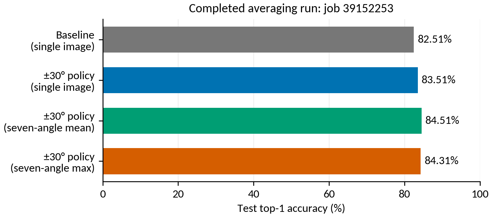
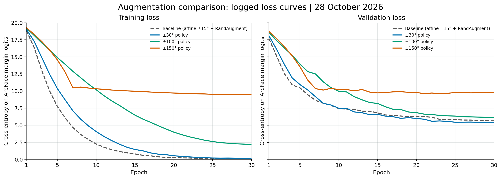
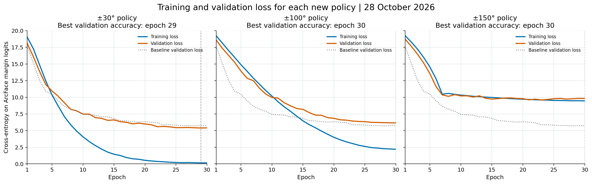
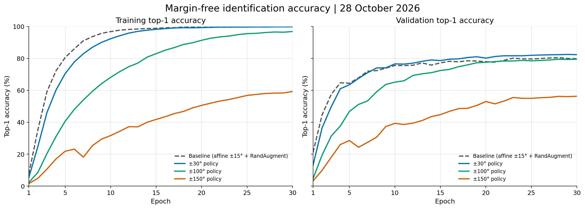

# Final Evaluation Report — Augmentation and Rotation Averaging — 28 October 2026

- Report date: 2026-10-28
- Revision: 2026-10-28; dedicated averaging-job results and figure added
- Word version: [formatted report matching the earlier progress report](../word/Macaque_ReID_Report_2026-10-28_Augmentation_Comparison.docx)
- Training date: 2026-10-26; all three policies completed 30 epochs
- Evaluation date: 2026-10-28 00:14:16 (selected test result, timestamp as logged)
- Model: ImageNet-pretrained ResNet50; 256-dimensional embeddings; ArcFace head
- Training loss: cross-entropy on ArcFace margin logits; margin 0.5; scale 30
- Dataset: 149 canonical identities; 6,665 train / 1,302 validation / 1,498 test crops
- Identity-registry version: 2026-10-14; this is the label-registry date, not the report date
- Device: CUDA / NVIDIA A100; one GPU per job
- Evaluation job: `39152253`, completed in 00:17:55, exit code `0:0`
- Baseline report: [23 October 2026 baseline evaluation](FINAL_EVAL_REPORT_2026-10-23_baseline.md)
- Saved comparison: [all 18 validation/test comparisons](../../artifacts/augmentation_sweeps/20261025T023752Z_jyY1BT/eval/comparison.csv)
- Experiment directory: [artifacts/augmentation_sweeps/20261025T023752Z_jyY1BT](../../artifacts/augmentation_sweeps/20261025T023752Z_jyY1BT)

## 1. Overall Metrics and Comparison with Baseline

**The ±30° training policy with seven-angle probability averaging is the best
configuration selected on validation.** It achieved **84.51%
test top-1 accuracy** and **82.84% macro F1**, compared
with 82.51% and 80.27% for the previous
single-image baseline. These are measured gains from one fit per policy; repeated-seed
reliability and statistical significance have not been established.

| Configuration | Test top-1 | Test top-3 | Test top-5 | Macro F1 | Weighted F1 |
| --- | --- | --- | --- | --- | --- |
| Previous baseline, single image | 82.51% | 88.65% | 89.85% | 80.27% | 82.39% |
| ±30° + seven-angle mean (selected) | 84.51% | 89.65% | 90.72% | 82.84% | 84.44% |

The measured top-1 improvement separates into **+1.00 percentage points**
for the ±30° training policy using single-image inference, followed by
**+1.00 percentage points** from averaging rotated views of that same model.
The combined gain is **+2.00 percentage points**, with **+2.57
percentage points** in macro F1. The selected model correctly identifies
**1266/1,498 images**, versus **1236/1,498**
for the baseline: a net gain of 30 images. Comparing predictions image by image,
it fixes 67 baseline errors and introduces 37 errors on images
the baseline got right.

### Averaging run results — job 39152253

The averaging evaluation **completed successfully on 28 October 2026 at 00:14:34**
(job start: 27 October at 23:56:39; elapsed **17m 55s**, exit code `0:0`). It scored
the saved ±30°, ±100° and ±150° models using a single image, probability averaging
and max pooling, on validation and test: **18 completed comparisons** in total.
Here, **Mean TTA means seven-angle probability averaging** and **Max TTA means
seven-angle maximum pooling**.

The table below isolates inference for the **same ±30° checkpoint**, selected at
training epoch 29. All seven views use −30°, −20°, −10°, 0°, +10°, +20° and +30°.

| Scoring method | Validation top-1 | Test top-1 | Test top-3 | Test top-5 | Test macro F1 | Correct test images |
| --- | --- | --- | --- | --- | --- | --- |
| Single image | 82.49% | 83.51% | 88.45% | 89.99% | 81.89% | 1251/1,498 |
| Seven-angle mean (selected) | 83.56% | 84.51% | 89.65% | 90.72% | 82.84% | 1266/1,498 |
| Seven-angle max | 83.26% | 84.31% | 89.45% | 90.65% | 82.51% | 1263/1,498 |

For this model, averaging adds **1.00 percentage point** over single-image
prediction: **84.51% versus 83.51%**, or **15 additional correct test images**.
Its macro F1 rises from **81.89% to 82.84%**. Max pooling reaches **84.31%**;
mean is higher by three test images. Mean was selected on validation (83.56%),
not by choosing the highest test score.

[PDF of the averaging-results figure](../figures/augmentation_comparison_2026-10-28/averaging_run_39152253.pdf).
The baseline bar uses ordinary inference; baseline TTA was not evaluated.

The averaging job evaluates existing weights. The loss-versus-epoch graphs later
in this report belong to the training runs; averaging does not produce a separate
training-loss curve. Its [job log](../../artifacts/augmentation_sweeps/20261025T023752Z_jyY1BT/logs/39152253_tta.out)
and [full comparison CSV](../../artifacts/augmentation_sweeps/20261025T023752Z_jyY1BT/eval/comparison.csv)
provide the source results. The newer follow-up averaging job `39484294` is a
separate submission for the ±45°/±60° models; it has no results in this report yet.

### Test results for every policy and pooling method

| Training policy | Single-image top-1 | Mean TTA top-1 | Max TTA top-1 | Mean TTA macro F1 |
| --- | --- | --- | --- | --- |
| Previous baseline | 82.51% | Not evaluated | Not evaluated | Not evaluated |
| ±30° policy | 83.51% | 84.51% | 84.31% | 82.84% |
| ±100° policy | 81.44% | 82.44% | 81.84% | 79.99% |
| ±150° policy | 56.94% | 58.41% | 57.48% | 46.36% |

Baseline TTA was not evaluated. Therefore the combined two-point gain compares a
new training policy plus TTA against the original baseline without TTA; it is not
an estimate of training augmentation alone. Mean exceeds max for the ±30° model by
only 0.20 percentage points (three test images), so that small difference should
not be treated as a robust general finding.

### Validation results used to select the configuration

| Training policy | Single-image top-1 | Mean TTA top-1 | Max TTA top-1 |
| --- | --- | --- | --- |
| Previous baseline | 80.49% | Not evaluated | Not evaluated |
| ±30° policy | 82.49% | 83.56% | 83.26% |
| ±100° policy | 79.49% | 81.26% | 80.72% |
| ±150° policy | 56.30% | 58.06% | 55.99% |

Each model's checkpoint was first chosen by its highest ordinary validation top-1
accuracy during training. The evaluation job then compared all nine model/pooling
combinations on validation, selected ±30° + mean, and only then scored the test set.
The selection is recorded in [selection.json](../../artifacts/augmentation_sweeps/20261025T023752Z_jyY1BT/eval/selection.json).

For the selected configuration, macro precision is 84.54%
and macro recall is 82.92%. Logit adjustment was disabled
(`tau=0`); the evaluation uses margin-free ArcFace logits throughout.

## 2. What Rotation Was Used Before?

The previous `strong` profile explicitly used **`RandomAffine(degrees=15)`**, which
samples an affine rotation from **−15° to +15°**. It then applied restricted
RandAugment with two operations and magnitude 5. In the installed torchvision
0.17.2 implementation, a selected `Rotate` operation contributes **+5° or −5°**;
operations are sampled sequentially and can repeat. The total baseline rotation
could therefore exceed ±15°. It should not be described as an unaugmented or
strictly ±15° baseline.

The new policies use one affine rotation step and do not add RandAugment rotations.
The names ±30°, ±100° and ±150° describe training angle ranges, not fixed rotations.

| Policy | Training rotation | Affine scale | Translation | Noise | Gaussian blur | Random erasing |
| --- | --- | --- | --- | --- | --- | --- |
| Baseline | Affine ±15°; RandAugment may add rotations | 0.90–1.10 | ±8% | No explicit Gaussian noise | 35%; σ 0.1–2.0; 5×5 | 30%; area 2–12% |
| ±30° | Single affine: −30° to +30° | 0.80–1.25 | ±10% | 35%; σ 0.03 | 40%; σ 0.2–2.0; 7×7 | 20%; area 2–10% |
| ±100° | Single affine: −100° to +100° | 0.70–1.35 | ±12% | 45%; σ 0.05 | 50%; σ 0.2–2.5; 7×7 | 25%; area 2–12% |
| ±150° | Single affine: −150° to +150° | 0.60–1.50 | ±15% | 50%; σ 0.08 | 60%; σ 0.3–3.0; 7×7 | 30%; area 2–15% |

The baseline also uses a random resized crop (area scale 0.8–1.0) and restricted
RandAugment. The new policies resize to 224×224 before the affine operation and
use explicit colour jitter instead of RandAugment. None of these four policies
uses horizontal mirroring. Noise sigma is specified for float images in [0,1]
before normalization. Scale and translation in the baseline row describe its
explicit affine step; its other geometry operations can add further variation.

At test time, TTA uses exactly **−30°, −20°, −10°, 0°, +10°, +20°, +30°**, regardless
of the training policy. Each view produces margin-free class logits followed by
softmax. Mean pools the seven probability vectors; max takes each class's maximum
view probability and renormalizes. TTA does not retrain or average model weights.

Implementation references: [local transforms](../../src/datasets/transforms.py),
[RandomAffine 0.17 documentation](https://docs.pytorch.org/vision/0.17/generated/torchvision.transforms.RandomAffine.html),
and [RandAugment 0.17.2 source](https://github.com/pytorch/vision/blob/v0.17.2/torchvision/transforms/autoaugment.py).

## 3. Loss-Function Graphs and Learning Curves

All curves below use the actual 30 logged epochs without smoothing. The model,
optimizer, learning-rate schedule, batch size and seed are held fixed across the
baseline and new runs: AdamW, initial LR 3e-4, weight decay 0.01, cosine schedule,
batch size 32 and seed 42.

**Loss interpretation:** both training and validation loss are the logged
cross-entropy on **margin-adjusted ArcFace logits**. The validation loop applies
the margin for its loss calculation, while validation accuracy and all final
evaluation scores use **margin-free** logits. Consequently these loss values are
not the cross-entropy of the final evaluation probabilities. Checkpoint selection
uses validation top-1 accuracy, not the minimum loss.

### Loss overview: baseline and all three policies

[Exportable PDF of the loss comparison](../figures/augmentation_comparison_2026-10-28/loss_comparison.pdf).
Both panels use the same loss scale.

### Training and validation loss for each new policy

[Exportable PDF of the per-policy loss curves](../figures/augmentation_comparison_2026-10-28/loss_by_policy.pdf).
Vertical dashed lines mark the checkpoint epochs selected by validation accuracy.
The dotted grey line is the previous baseline's validation loss.

### Accuracy corresponding to those loss curves

[Exportable PDF of the accuracy curves](../figures/augmentation_comparison_2026-10-28/accuracy_comparison.pdf).
Training accuracy is measured on each policy's augmented inputs; validation uses
the common unaugmented inputs. Training accuracies therefore reflect different
input difficulty, rather than a shared clean-training benchmark.

| Policy | Training job | Best epoch | Best val top-1 | Final train top-1 | Final train loss | Final val loss | Wall time |
| --- | --- | --- | --- | --- | --- | --- | --- |
| Baseline (affine ±15° + RandAugment) | 38494871 | 28 | 80.49% | 99.79% | 0.096 | 5.742 | 00:24:36 |
| ±30° policy | 39152252_0 | 29 | 82.49% | 99.82% | 0.153 | 5.407 | 00:26:12 |
| ±100° policy | 39152252_1 | 30 | 79.49% | 96.83% | 2.191 | 6.160 | 00:12:15 |
| ±150° policy | 39152252_2 | 30 | 56.30% | 59.29% | 9.456 | 9.814 | 00:27:54 |

Loss/accuracy data and source CSV hashes are included in
[plot_data.json](../figures/augmentation_comparison_2026-10-28/plot_data.json). Wall times include startup,
data validation and I/O, so they are not a controlled comparison of compute speed.

## 4. Per-class Summary for the Selected Model

- Per-class metrics: [selected ±30° + mean per-class CSV](../../artifacts/augmentation_sweeps/20261025T023752Z_jyY1BT/eval/train_macaque_arcface_aggressive_rot30_macaque-resnet50-arcface_aggressive_rot30_canonical_20261014_best_macaque-resnet50-arcface_aggressive_rot30_canonical_20261014_mean_test_tta_mean_per_class_metrics.csv)
- Per-image predictions: [selected model predictions and hard examples](../../artifacts/augmentation_sweeps/20261025T023752Z_jyY1BT/eval/train_macaque_arcface_aggressive_rot30_macaque-resnet50-arcface_aggressive_rot30_canonical_20261014_best_macaque-resnet50-arcface_aggressive_rot30_canonical_20261014_mean_test_tta_mean_hard_examples.csv)
- Full evaluation summary: [selected model metrics JSON](../../artifacts/augmentation_sweeps/20261025T023752Z_jyY1BT/eval/train_macaque_arcface_aggressive_rot30_macaque-resnet50-arcface_aggressive_rot30_canonical_20261014_best_macaque-resnet50-arcface_aggressive_rot30_canonical_20261014_mean_test_tta_mean_metrics_summary.json)
- Confusion matrix: [149×149 matrix in NumPy format](../../artifacts/augmentation_sweeps/20261025T023752Z_jyY1BT/eval/train_macaque_arcface_aggressive_rot30_macaque-resnet50-arcface_aggressive_rot30_canonical_20261014_best_macaque-resnet50-arcface_aggressive_rot30_canonical_20261014_mean_test_tta_mean_confusion_matrix.npy)

The five lowest-recall identities for the selected configuration are:

| Identity | Test images | Recall / per-class accuracy | F1 |
| --- | --- | --- | --- |
| Caro | 3 | 0.00% | 0.00% |
| Racoon | 4 | 25.00% | 40.00% |
| Scarlet | 5 | 40.00% | 33.33% |
| Adele | 8 | 50.00% | 57.14% |
| Carole | 4 | 50.00% | 44.44% |

One identity has zero test recall. Low-support identities
remain sensitive to individual errors; overall accuracy alone does not describe
all individuals equally. New embedding projections were not computed by this
comparison job, so the baseline's t-SNE plot is not reused for the new model.

## 5. Interpretation

The ±30° policy improves both single-image validation and test accuracy over the
baseline. Averaging seven rotated views adds a further measured gain. This supports
moderate additional augmentation and rotation averaging for this experiment.

The ±100° and ±150° policies perform worse under the same 30-epoch budget. The
±150° model finishes with only 59.29% accuracy on its augmented training batches
and 56.30% validation accuracy. This is consistent with difficulty fitting the
strongly transformed inputs at this budget. It does not establish that longer
training would outperform the moderate policy.

A plausible mechanism is that large rotations, zoom and translation push useful
regions outside the fixed crop, while stronger noise, blur and erasing reduce
the remaining identity cues. This is an interpretation, not a separately measured
cause. Each policy changes several operations together, and the baseline uses a
different crop/RandAugment pipeline, so these results do not isolate rotation,
noise, or any other operation individually.

## 6. Known Limitations and Reproducibility

- One seed and one training fit per policy; no repeated-seed confidence interval
  or significance claim is made.
- Baseline TTA was not tested, so the effect of adding the same inference ensemble
  to the old model remains unknown.
- This is a fixed-budget comparison. More epochs or a different optimization
  schedule could change the ranking, but that has not been evaluated.
- All nine new test evaluations were checked against the baseline's exact 1,498
  `(image path, true identity)` pairs. No new split or label order is introduced.
- The split manifest and identity-registry hashes match the suite's saved
  [data-input provenance](../../artifacts/augmentation_sweeps/20261025T023752Z_jyY1BT/data_inputs.json).
- Training logs: [artifacts/augmentation_sweeps/20261025T023752Z_jyY1BT/logs](../../artifacts/augmentation_sweeps/20261025T023752Z_jyY1BT/logs). Training
  used jobs `39152252_0`, `_1`, `_2`; evaluation used `39152253`; all completed
  successfully with exit code `0:0`.
- Best and final checkpoints, 30-epoch CSVs, per-image/per-class evaluation files,
  and the seven-view probability arrays remain in the experiment directory.

The selected checkpoint is:

`artifacts/augmentation_sweeps/20261025T023752Z_jyY1BT/checkpoints/macaque-resnet50-arcface_aggressive_rot30_canonical_20261014_best.pt`

The measured result favours **the ±30° policy with mean probability TTA**. A small
follow-up at **±45° and ±60°** would be worth considering, with noise, blur, scale,
translation, erasing, split and the 30-epoch budget held at the ±30° policy's
settings. This would assess rotation range directly; the present policies change
several settings together and do not locate an optimal angle. Select on validation
and consider repeating the strongest candidates across seeds before expanding the
search. Evaluating the old baseline checkpoint with the same TTA is another useful
comparison that would not require retraining. These are suggestions only. No new
jobs, training trials or model evaluations were launched for this documentation work.
