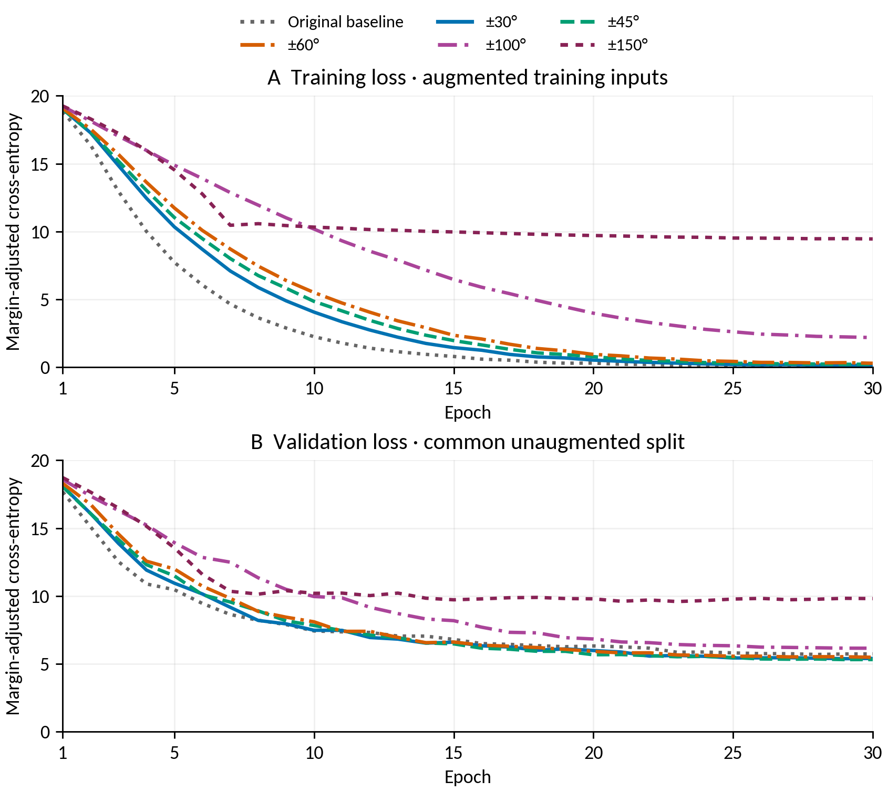
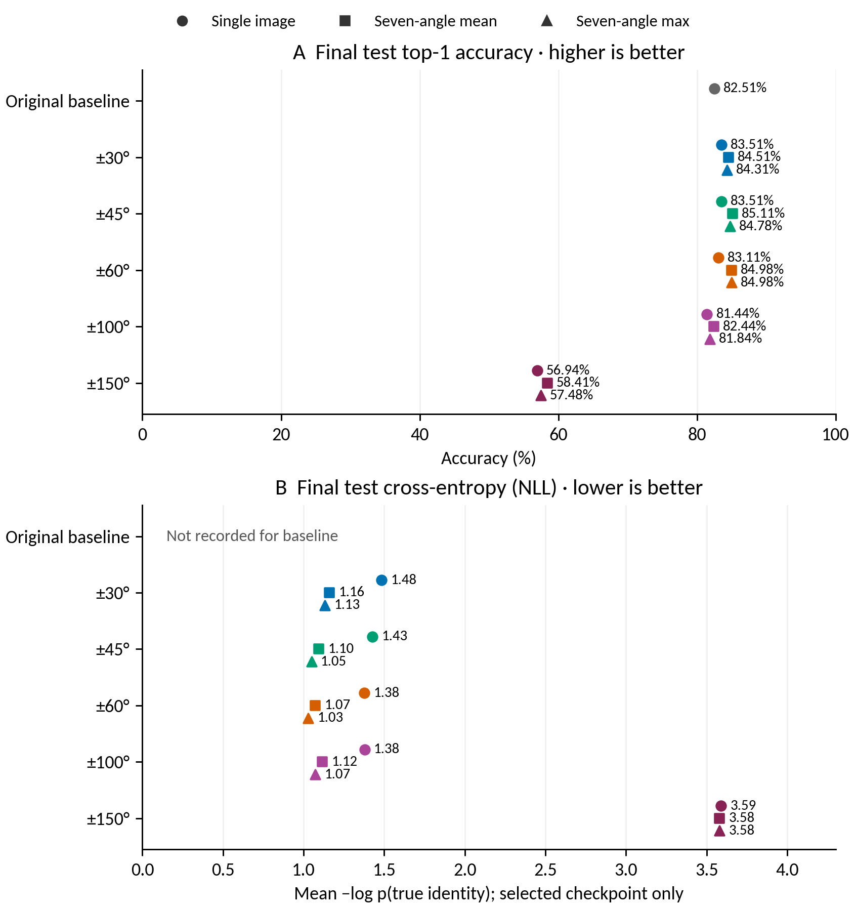
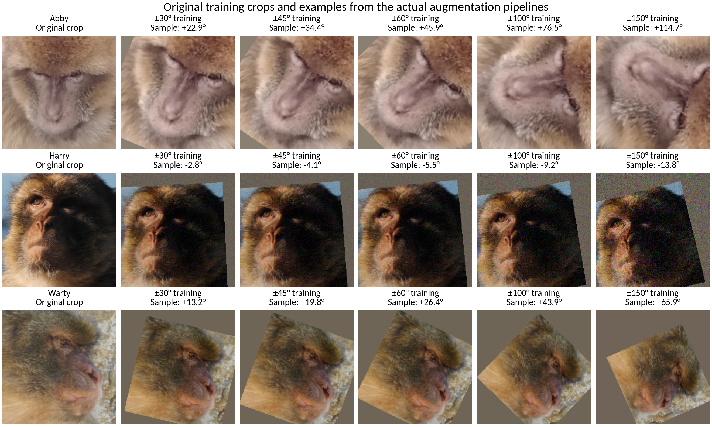
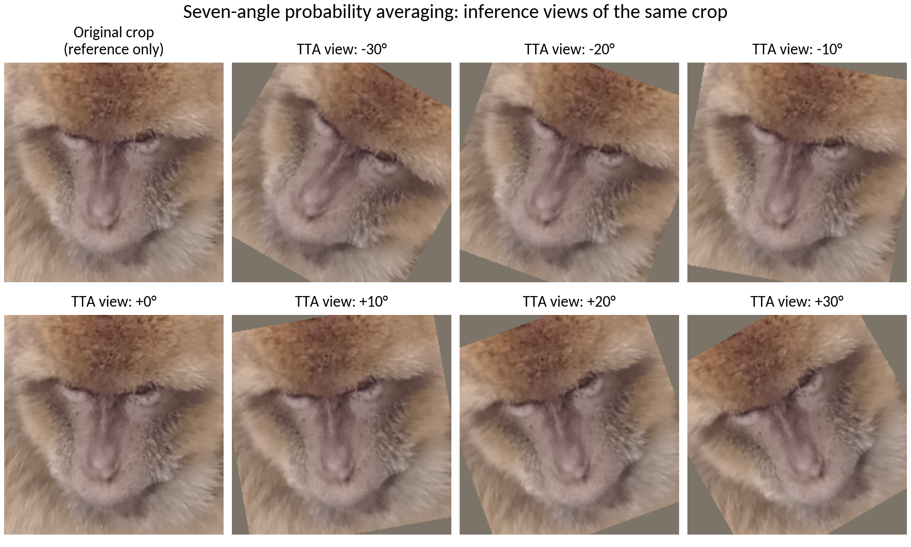
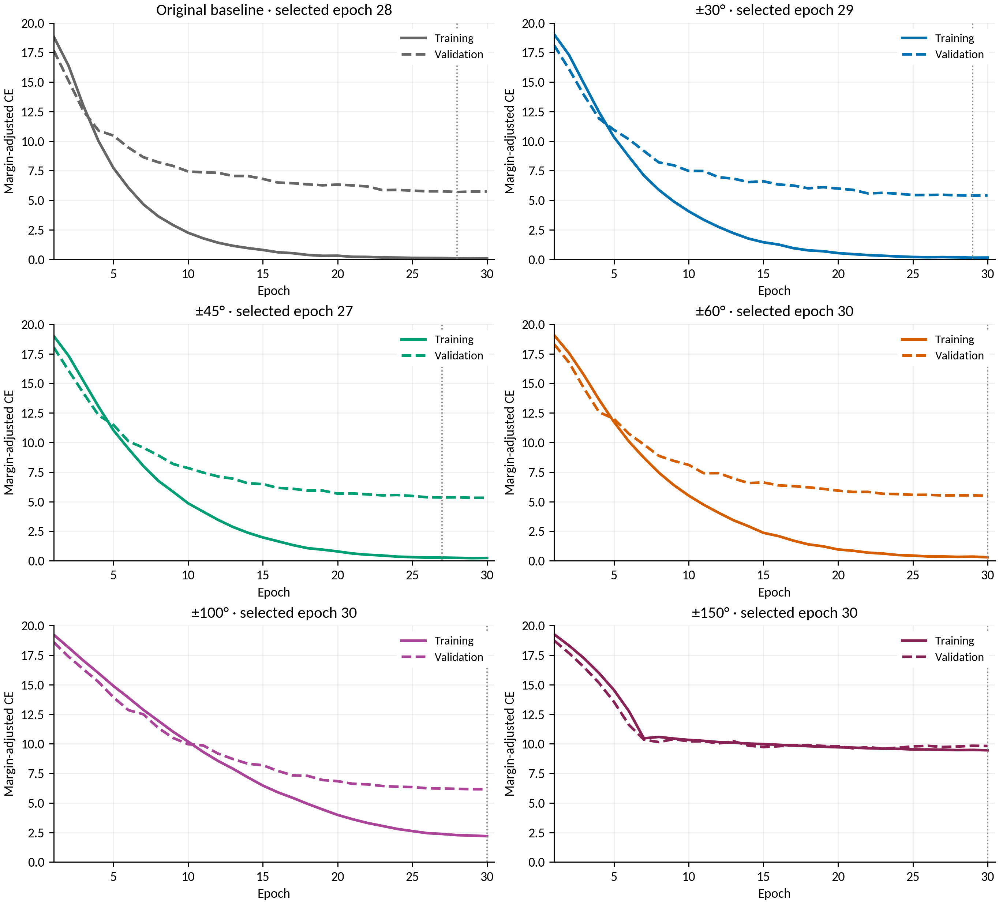
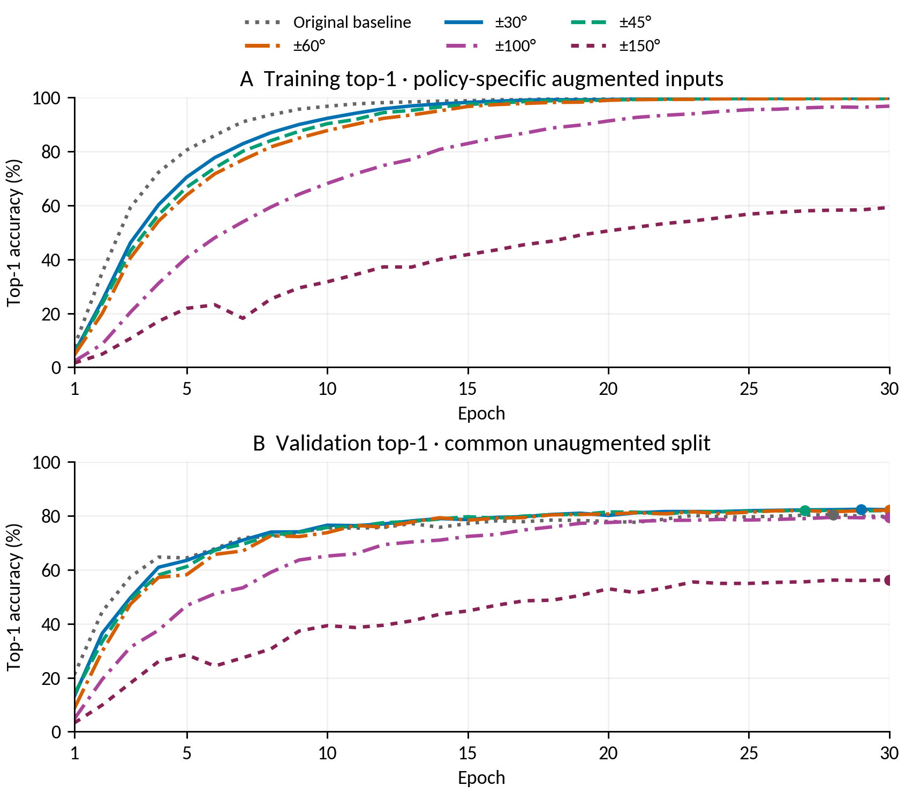

# Macaque Re-identification — All-policy Comparison — 28 October 2026

- Report date: **28 October 2026**; revised **30 October 2026** for supervisor review.
- Scope: original baseline plus ±30°, ±45°, ±60°, ±100° and ±150° training policies; one fit per policy.
- Cohort: **149 identities; 6,665 training / 1,302 validation / 1,498 test crops**; registry dated 14 October 2026.
- Model: ImageNet-pretrained ResNet50, 256-dimensional embeddings, ArcFace margin 0.5 / scale 30; 30 training epochs.
- [Word report](../word/Macaque_ReID_Report_2026-10-28_Augmentation_Comparison.docx) · [PDF for sharing](../pdf/Macaque_ReID_Report_2026-10-28_Augmentation_Comparison.pdf) · [Combined comparison data](../figures/augmentation_comparison_2026-10-28/supervisor_comparison/comparison_data.json).

## 1. Findings for supervisor discussion

**±45° training with seven-angle mean probability averaging is the current
validation-based choice.** It identifies **1,275/1,498 test images (85.11%)**, with
**83.74% macro F1**. This is **0.60 percentage points / nine images** above ±30°
mean and **2.60 points / 39 images** above the original baseline without TTA.

The comparison supports three distinct findings:

- **Single-image performance:** ±30° has the highest validation top-1 (82.49%). ±30° and ±45° tie on single-image test top-1 (83.51%); ±60° scores 83.11%.
- **Averaging:** ±45° mean reaches 85.11% test top-1; ±60° mean reaches 84.98%; ±30° mean reaches 84.51%. Both ±30° mean and ±45° mean score 83.56% on validation; ±45° has higher validation macro F1 (80.11% versus 79.82%).
- **Strength and reliability:** ±100° and ±150° have lower test top-1 at this 30-epoch budget. The ±30°/±45°/±60° differences are small and have not been confirmed across training seeds.

| Training policy | Validation single | Validation mean | Test single | Test mean | Test mean macro F1 |
| --- | --- | --- | --- | --- | --- |
| Original baseline | 80.49% | Not evaluated | 82.51% | Not evaluated | Not evaluated |
| ±30° | 82.49% | 83.56% | 83.51% | 84.51% | 82.84% |
| ±45° | 82.10% | 83.56% | 83.51% | 85.11% | 83.74% |
| ±60° | 82.18% | 83.41% | 83.11% | 84.98% | 83.37% |
| ±100° | 79.49% | 81.26% | 81.44% | 82.44% | 79.99% |
| ±150° | 56.30% | 58.06% | 56.94% | 58.41% | 46.36% |

All percentages above refer to top-1 accuracy except the final F1 column.
“Single” uses one unrotated image. “Mean” averages seven probability vectors at
−30°, −20°, −10°, 0°, +10°, +20°, +30°. Baseline TTA was not evaluated.
The original baseline uses affine ±15° plus possible RandAugment rotation.

[One-page comparison sheet for the meeting (landscape PDF)](../figures/augmentation_comparison_2026-10-28/supervisor_comparison/one_page_overview.pdf).

## 2. Training and validation learning curves — all policies together

The same policy colours and ordering are used throughout this report. Both loss
panels show **all six policies, all 30 epochs, without smoothing**, on a common
**0–20 loss scale**. This replaces the separate original/follow-up comparison in
the main results presentation.

**Figure 1. Shared learning-curve comparison.** Panel A shows training loss on
each policy's augmented inputs; panel B shows validation loss on the same clean
validation cohort. Training inputs differ in difficulty, so training loss alone
does not rank generalisation. Both logged losses use cross-entropy with the
label-dependent ArcFace training margin. Checkpoints were selected by ordinary
validation top-1, not minimum loss. [Full-size PDF](../figures/augmentation_comparison_2026-10-28/supervisor_comparison/all_policy_loss.pdf).

## 3. Final held-out test comparison — accuracy and cross-entropy

The test set provides one final comparison per saved checkpoint and inference
method. **No epoch-by-epoch test-loss series was recorded.** The figure therefore
shows final test accuracy and final test cross-entropy as checkpoint summaries.
It includes all three inference methods for every evaluated policy.

**Figure 2. Final test comparison on the same 1,498 images.** Higher top-1 is
better; lower cross-entropy is better. Marker shape identifies inference method;
policy colours match Figure 1. Baseline test loss is **not recorded**, and its
TTA methods are **not evaluated**; neither missing result is represented as zero.
[Full-size PDF](../figures/augmentation_comparison_2026-10-28/supervisor_comparison/final_test_comparison.pdf).

### Detailed final test results

| Training policy | Single top-1 | Mean top-1 | Max top-1 | Mean macro F1 |
| --- | --- | --- | --- | --- |
| Original baseline | 82.51% | Not evaluated | Not evaluated | Not evaluated |
| ±30° | 83.51% | 84.51% | 84.31% | 82.84% |
| ±45° | 83.51% | 85.11% | 84.78% | 83.74% |
| ±60° | 83.11% | 84.98% | 84.98% | 83.37% |
| ±100° | 81.44% | 82.44% | 81.84% | 79.99% |
| ±150° | 56.94% | 58.41% | 57.48% | 46.36% |

#### Test cross-entropy (NLL), lower is better

| Training policy | Single NLL | Mean NLL | Max NLL |
| --- | --- | --- | --- |
| Original baseline | Not recorded | Not evaluated | Not evaluated |
| ±30° | 1.4832 | 1.1607 | 1.1313 |
| ±45° | 1.4272 | 1.0951 | 1.0486 |
| ±60° | 1.3775 | 1.0730 | 1.0283 |
| ±100° | 1.3789 | 1.1162 | 1.0730 |
| ±150° | 3.5889 | 3.5798 | 3.5799 |

### Loss values and checkpoint timing

| Training policy | Selected epoch | Train CE at epoch 30 | Validation CE at epoch 30 | Test NLL single | Test NLL mean |
| --- | --- | --- | --- | --- | --- |
| Original baseline | 28 | 0.0959 | 5.7418 | Not recorded | Not evaluated |
| ±30° | 29 | 0.1535 | 5.4072 | 1.4832 | 1.1607 |
| ±45° | 27 | 0.2350 | 5.3246 | 1.4272 | 1.0951 |
| ±60° | 30 | 0.2986 | 5.4917 | 1.3775 | 1.0730 |
| ±100° | 30 | 2.1910 | 6.1596 | 1.3789 | 1.1162 |
| ±150° | 30 | 9.4555 | 9.8135 | 3.5889 | 3.5798 |

**The test columns describe the selected checkpoint; the learning-loss columns
describe epoch 30.** Train/validation CE includes the ArcFace margin; final test
NLL uses the margin-free prediction probabilities. They are reported together
for completeness but use separate plot panels and definitions. Their numerical
magnitudes should not be read as a directly comparable train–test loss gap.

[Test cross-entropy CSV](../figures/augmentation_comparison_2026-10-28/supervisor_comparison/final_test_cross_entropy.csv)
· [All source hashes, checks and curve values](../figures/augmentation_comparison_2026-10-28/supervisor_comparison/comparison_data.json).

## 4. Augmentation settings and meeting examples

The previous `strong` profile explicitly used **`RandomAffine(degrees=15)`**, which
samples an affine rotation from **−15° to +15°**. It then applied restricted
RandAugment with two operations and magnitude 5. In the installed torchvision
0.17.2 implementation, a selected `Rotate` operation contributes **+5° or −5°**;
operations are sampled sequentially and can repeat. The total baseline rotation
could therefore exceed ±15°. It should not be described as an unaugmented or
strictly ±15° baseline.

The new policies use one affine rotation step and do not add RandAugment rotations.
The names ±30°, ±45°, ±60°, ±100° and ±150° describe training angle ranges, not fixed rotations. Only rotation differs among the ±30°/±45°/±60° policies; the ±100°/±150° policies also change other augmentation settings.

| Policy | Training rotation | Affine scale | Translation | Noise | Gaussian blur | Random erasing |
| --- | --- | --- | --- | --- | --- | --- |
| Baseline | Affine ±15°; RandAugment may add rotations | 0.90–1.10 | ±8% | No explicit Gaussian noise | 35%; σ 0.1–2.0; 5×5 | 30%; area 2–12% |
| ±30° | Single affine: −30° to +30° | 0.80–1.25 | ±10% | 35%; σ 0.03 | 40%; σ 0.2–2.0; 7×7 | 20%; area 2–10% |
| ±45° | Single affine: −45° to +45° | 0.80–1.25 | ±10% | 35%; σ 0.03 | 40%; σ 0.2–2.0; 7×7 | 20%; area 2–10% |
| ±60° | Single affine: −60° to +60° | 0.80–1.25 | ±10% | 35%; σ 0.03 | 40%; σ 0.2–2.0; 7×7 | 20%; area 2–10% |
| ±100° | Single affine: −100° to +100° | 0.70–1.35 | ±12% | 45%; σ 0.05 | 50%; σ 0.2–2.5; 7×7 | 25%; area 2–12% |
| ±150° | Single affine: −150° to +150° | 0.60–1.50 | ±15% | 50%; σ 0.08 | 60%; σ 0.3–3.0; 7×7 | 30%; area 2–15% |

The baseline also uses a random resized crop (area scale 0.8–1.0) and restricted
RandAugment. The new policies resize to 224×224 before the affine operation and
use explicit colour jitter instead of RandAugment. None of these six policies
uses horizontal mirroring. Noise sigma is specified for float images in [0,1]
before normalization. Scale and translation in the baseline row describe its
explicit affine step; its other geometry operations can add further variation.

At test time, TTA uses exactly **−30°, −20°, −10°, 0°, +10°, +20°, +30°**, regardless
of the training policy. Each view produces margin-free class logits followed by
softmax. Mean pools the seven probability vectors; max takes each class's maximum
view probability and renormalizes. TTA does not retrain or average model weights.

Implementation references: [local transforms](../../src/datasets/transforms.py),
[RandomAffine 0.17 documentation](https://docs.pytorch.org/vision/0.17/generated/torchvision.transforms.RandomAffine.html),
and [RandAugment 0.17.2 source](https://github.com/pytorch/vision/blob/v0.17.2/torchvision/transforms/autoaugment.py).

### Meeting examples: original and augmented training images

For the meeting discussion, the following sheets show
**real training-set crops alongside examples generated with the actual training
augmentation code**. They use Abby, Harry and Warty; the sources are training
images, not validation/test images chosen for their prediction results.

**Figure 3. Original training crops and sampled full-pipeline augmentation.** Each row uses the same source crop across the five policies.

**How to read the training sheet.** Each row starts with the same original face
crop, resized to 224×224 without augmentation for display. The other columns are
random samples from the full training pipelines, including affine rotation/zoom/
translation, colour jitter and probabilistic blur, noise and erasing. Column
headings give the configured rotation range; the sampled rotation is printed
below it. The ±30°/±45°/±60° policies share all other settings, while ±100°/±150°
also increase other augmentation strengths. The same seed is reset across policies
within each row (42, 43 and 44), so the illustrations can be reproduced.

These are **newly generated illustrations**, not exact images recovered from
past training batches. Normalization is reversed and values are clipped to [0,1]
for viewing. Grey affine borders and any erased patches are pipeline outputs.
No horizontal mirroring is used. The source originals are existing detection
crops rather than full camera photographs.

[Training sheet: full-size PNG](../figures/augmentation_comparison_2026-10-28/meeting_examples/original_and_training_augmentations.png)
· [PDF for presenting or printing](../figures/augmentation_comparison_2026-10-28/meeting_examples/original_and_training_augmentations.pdf)
· [Individual originals and augmented images](../figures/augmentation_comparison_2026-10-28/meeting_examples/)

### Meeting examples: the seven inference views used for averaging

**Figure 4. Seven deterministic inference views and an original reference.** The reference is not an eighth inference view.

This second sheet illustrates **test-time augmentation (TTA)** using the Abby
training crop only as a demonstration image. The original panel is a reference;
it is not an eighth inference view. The seven views include 0° exactly once.
Each view is resized/rotated and scored by the same saved model; their **class
probabilities are averaged**, not their pixels or model weights. TTA does not
apply the random training colour jitter, noise, blur or erasing. Its seven angles
remain ±30° through 0° even for models trained with ±45° or ±60°.

[Inference-view sheet: full-size PNG](../figures/augmentation_comparison_2026-10-28/meeting_examples/seven_angle_inference_views.png)
· [PDF for presenting or printing](../figures/augmentation_comparison_2026-10-28/meeting_examples/seven_angle_inference_views.pdf)
· [Source paths, image hashes, seeds and transform parameters](../figures/augmentation_comparison_2026-10-28/meeting_examples/examples_manifest.json)
· [Reproduction script](../figures/augmentation_comparison_2026-10-28/meeting_examples/generate_examples.py)

## 5. Interpretation and individual-level results

Moderate augmentation and seven-angle averaging perform best in this experiment.
The ±45° mean model correctly identifies 1,275 test images, compared with 1,266
for ±30° mean and 1,236 for the original baseline. Its averaging gain over its
own single-image result is **1.60 points / 24 images**. Image-by-image comparison
with the baseline fixes **72 errors** and introduces **33 errors**, a net gain
of 39. Macro precision is **85.15%** and macro recall is **84.09%**.

**Metric trade-off.** ±45° mean has the highest test top-1. ±60° mean has lower
test NLL than ±45° mean (1.0730 versus 1.0951), and ±60° max has the lowest
measured NLL (1.0283). NLL scores the probability assigned to the true identity,
including confident mistakes; top-1 counts correct classifications. These test
descriptions do not change the validation-based choice.

The ±150° policy finishes with only 59.29% accuracy on its augmented training
inputs and 56.30% validation accuracy. The shared curves show that it has
difficulty fitting this training task at the chosen budget. Longer training has
not been tested. Strong rotation/zoom may crop away identity cues, and noise,
blur and erasing may obscure them; this mechanism is an interpretation rather
than a separately measured cause.

The ±30°/±45°/±60° follow-up changes only rotation range while holding other
settings fixed. Comparisons with the baseline or ±100°/±150° change several
augmentation settings together. Neither comparison establishes a robust optimal
angle from a single fit per policy.

### Per-identity results for ±45° + mean

- Per-class metrics: [selected ±45° + mean per-class CSV](../../artifacts/augmentation_sweeps/20261028T164412Z_JmVXbV/eval/train_macaque_arcface_aggressive_rot45_macaque-resnet50-arcface_aggressive_rot45_canonical_20261014_best_macaque-resnet50-arcface_aggressive_rot45_canonical_20261014_mean_test_tta_mean_per_class_metrics.csv)
- Per-image predictions: [selected model predictions and hard examples](../../artifacts/augmentation_sweeps/20261028T164412Z_JmVXbV/eval/train_macaque_arcface_aggressive_rot45_macaque-resnet50-arcface_aggressive_rot45_canonical_20261014_best_macaque-resnet50-arcface_aggressive_rot45_canonical_20261014_mean_test_tta_mean_hard_examples.csv)
- Full evaluation summary: [selected model metrics JSON](../../artifacts/augmentation_sweeps/20261028T164412Z_JmVXbV/eval/train_macaque_arcface_aggressive_rot45_macaque-resnet50-arcface_aggressive_rot45_canonical_20261014_best_macaque-resnet50-arcface_aggressive_rot45_canonical_20261014_mean_test_tta_mean_metrics_summary.json)
- Confusion matrix: [149×149 matrix in NumPy format](../../artifacts/augmentation_sweeps/20261028T164412Z_JmVXbV/eval/train_macaque_arcface_aggressive_rot45_macaque-resnet50-arcface_aggressive_rot45_canonical_20261014_best_macaque-resnet50-arcface_aggressive_rot45_canonical_20261014_mean_test_tta_mean_confusion_matrix.npy)

The five lowest-recall identities for the selected configuration are:

| Identity | Test images | Recall / per-class accuracy | F1 |
| --- | --- | --- | --- |
| Caro | 3 | 0.00% | 0.00% |
| Thief | 3 | 33.33% | 50.00% |
| Harry | 7 | 42.86% | 54.55% |
| Racoon | 4 | 50.00% | 66.67% |
| Nathalie | 9 | 55.56% | 62.50% |

One identity has zero test recall. Low-support identities
remain sensitive to individual errors; overall accuracy alone does not describe
all individuals equally. New embedding projections were not computed by this
comparison job, so the baseline's t-SNE plot is not reused for the new model.

## 6. Limitations, selection and reproducibility

- **Selection:** saved checkpoints use the best ordinary validation top-1. The original job selected ±30° mean among nine model/method combinations; the follow-up selected ±45° mean among six. Both choices were locked before their test scoring. Across suites, the two mean methods tie at exactly 1,088/1,302 validation images; validation macro F1 favours ±45° under the recorded tie-break rule.
- **One fit per policy:** the measured nine-image advantage over ±30° mean is not a repeated-seed confidence interval or evidence of statistical significance. Test NLL is descriptive and was not used to change the selection.
- **Metric definitions:** training/validation loss includes the ArcFace training margin; final test NLL uses margin-free probabilities. No per-epoch test loss exists in these runs. Baseline test NLL is missing and baseline TTA was not evaluated.
- **Matched cohort:** all 15 augmented-model test prediction files use the baseline's exact 1,498 image/identity pairs. Both suites' split-manifest and registry SHA-256 pairs match. Registry date 14 October is not an experiment date.
- **Training control:** ImageNet-pretrained ResNet50, 256-dimensional embedding, ArcFace margin 0.5 / scale 30, AdamW LR 3e-4 / weight decay 0.01, cosine schedule, batch size 32, seed 42, GPU/AMP and 30 epochs. Logit adjustment was disabled (tau=0). Training accuracy is measured on augmented inputs of different difficulty.
- **Next evidence:** repeat the strongest candidates across seeds; evaluate baseline TTA if a matched inference comparison is needed. This documentation revision derives metrics from saved outputs and launches no additional model jobs.

The selected follow-up checkpoint is
`artifacts/augmentation_sweeps/20261028T164412Z_JmVXbV/checkpoints/macaque-resnet50-arcface_aggressive_rot45_canonical_20261014_best.pt`.

### Final test-loss calculation

**How test loss was obtained.** The original evaluation summaries report accuracy
and F1, but do not store loss. For the five augmented models, this revision
derives **NLL = mean[−ln p(true identity)]** from the saved test probabilities.
Mean/max use the saved pooled probabilities; single-image NLL uses the cached
0° view. Every recovered prediction and top-1 confidence was checked against
the corresponding recorded single/mean/max output. All true-class probabilities
are positive; the calculation uses float64 logs without clipping. No model
inference, training, new checkpoint selection or test-driven tuning was run.

The baseline's full probability arrays were not saved, so its NLL cannot be
recovered from the available summaries. These final test NLL values are
**margin-free**; the training/validation curves retain the **margin-adjusted**
objective actually logged during fitting.

## Appendix A. All-policy diagnostic loss panels

**Figure 5. Per-policy detail using a common 0–20 loss scale.** Solid lines show
training, dashed lines validation, and vertical dotted lines the recorded
selected epochs. The colours and policy ordering match the main comparison.
[Full-size diagnostic PDF](../figures/augmentation_comparison_2026-10-28/supervisor_comparison/all_policy_diagnostics.pdf).

## Appendix B. All-policy training and validation accuracy

**Figure 6. Corresponding accuracy curves for all policies.** Dots mark the
recorded selected epochs on the validation curves. Training accuracy uses
policy-specific augmented inputs; validation uses the common clean split.
[Full-size accuracy PDF](../figures/augmentation_comparison_2026-10-28/supervisor_comparison/all_policy_accuracy.pdf).

## Appendix C. Source records and completed jobs

### Source artifacts

- [Combined curve values, source hashes and cached-probability checks](../figures/augmentation_comparison_2026-10-28/supervisor_comparison/comparison_data.json).
- [Reproduce the consolidated figures and final test NLL](../figures/augmentation_comparison_2026-10-28/build_supervisor_comparison.py).
- [Original 18 validation/test comparisons](../../artifacts/augmentation_sweeps/20261025T023752Z_jyY1BT/eval/comparison.csv) and [follow-up 12 comparisons](../../artifacts/augmentation_sweeps/20261028T164412Z_JmVXbV/eval/comparison.csv).
- [Original selection record](../../artifacts/augmentation_sweeps/20261025T023752Z_jyY1BT/eval/selection.json) and [follow-up selection record](../../artifacts/augmentation_sweeps/20261028T164412Z_JmVXbV/eval/selection.json).
- [Original data provenance](../../artifacts/augmentation_sweeps/20261025T023752Z_jyY1BT/data_inputs.json) and [follow-up data provenance](../../artifacts/augmentation_sweeps/20261028T164412Z_JmVXbV/data_inputs.json).
- [Baseline evaluation report](FINAL_EVAL_REPORT_2026-10-23_baseline.md).

### Completed jobs

| Job | Task | Completion | Elapsed |
| --- | --- | --- | --- |
| 38494871 | Baseline training | 23 October | 24m 36s |
| 39152252_0 | ±30° training | 26 October | 26m 12s |
| 39152252_1 | ±100° training | 26 October | 12m 15s |
| 39152252_2 | ±150° training | 26 October | 27m 54s |
| 39152253 | Original averaging comparison | 28 October | 17m 55s |
| 39484293_0 | ±45° training | 28 October | 26m 24s |
| 39484293_1 | ±60° training | 28 October | 26m 24s |
| 39484294 | Follow-up averaging comparison | 29 October | 30m 12s |

All listed jobs completed with exit code 0:0. Wall times include startup and I/O
and are not controlled compute-speed comparisons. Training/evaluation dates are
in 2026. Source logs: [original suite](../../artifacts/augmentation_sweeps/20261025T023752Z_jyY1BT/logs)
and [follow-up suite](../../artifacts/augmentation_sweeps/20261028T164412Z_JmVXbV/logs).

